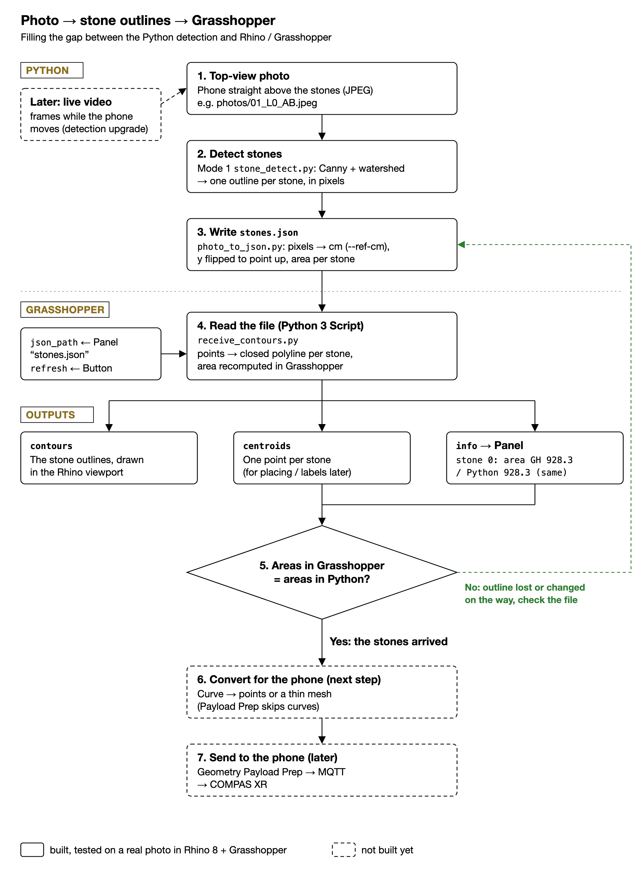
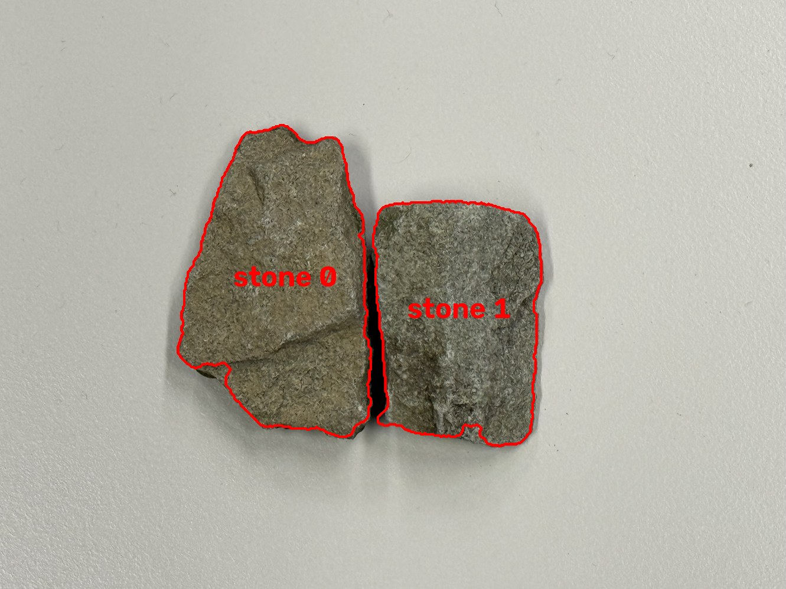
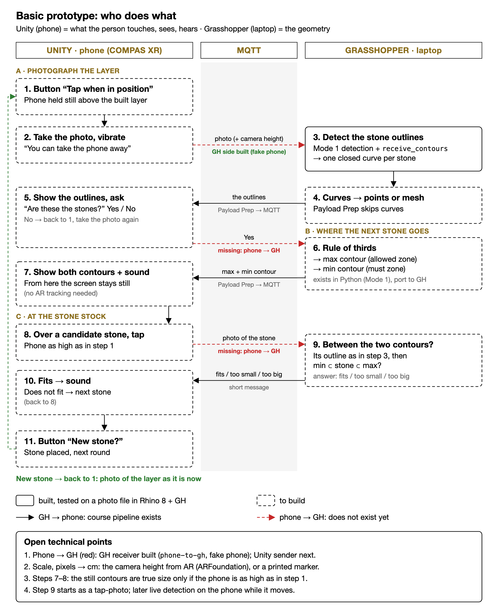

# Photo → stone outlines → Grasshopper

One small step of the pipeline, on its own. Following the midterm feedback
(break it down, no "final product" code), this folder only does:

> **The stone outlines that the Python detection finds in a photo arrive in Grasshopper as curves, and we can check that they arrived unchanged.**

Until now the outlines stayed inside Python (Mode 1, live-stone-on-paper);
nothing carried them into Rhino / Grasshopper. No MQTT, no phone, no rule of
thirds here.



## The step broken down

| # | what | technique | status |
|---|---|---|---|
| 1 | Top-view photo of the stones | phone, JPEG | real photo `../photos/01_L0_AB.jpeg` |
| 2 | Find each stone's outline | Mode 1 `stone_detect.py` (Canny + watershed), reused unchanged | done |
| 3 | Write the outlines to a file | `python/photo_to_json.py`: pixels → cm, image y (down) → Rhino y (up), fewer points (`approxPolyDP`) | done |
| 4 | Grasshopper reads the file | Python 3 Script `grasshopper/receive_contours.py` → closed polyline per stone | done, tested in Rhino 8 + GH |
| 5 | Did they arrive unchanged? | area recomputed in GH (`AreaMassProperties`) vs. Python's area, per stone → `info` Panel | done |
| 6 | Convert for the phone | curve → points or mesh (see below) | next |

Why a file (JSON) in between: Grasshopper's Python cannot import OpenCV
easily, and a file can be opened and checked by hand. Later the same JSON
could also go over MQTT instead of the disk.



## Try it (1 minute)

1. Rhino 8 → `Grasshopper` → *File → Open* [`demo/receive_contours.gh`](demo/receive_contours.gh).
   It reads [`demo/stones.json`](demo/stones.json), made from
   `../photos/01_L0_AB.jpeg`.
2. The `info` Panel shows:

   ```
   2 stones from photo 01_L0_AB.jpeg, unit cm
   stone 0: area GH 928.3 / Python 928.3 cm2 (same), 275 points
   stone 1: area GH 743.9 / Python 743.9 cm2 (same), 217 points
   ```
   and the two outlines are drawn in the Rhino viewport (zoom extents),
   about 0–110 × 0–85 from the origin.

With your own photo (needs the Mode 1 venv, `../mode1-rule-of-thirds/.venv`):

```bash
cd python
../../mode1-rule-of-thirds/.venv/bin/python photo_to_json.py ../../photos/02_L0_C.jpeg --ref-cm 45
```

This overwrites `demo/stones.json`; press the `refresh` Button in Grasshopper.

**Scale:** `--ref-cm` is the real length of the biggest stone (long side).
The 45 cm used for the demo is a placeholder, not measured: measure the
stone and use the real number, otherwise all sizes are off by the same
factor. Without `--ref-cm` everything stays in pixels.

## Files

| file | what |
|---|---|
| `python/photo_to_json.py` | photo → `stones.json` (reuses Mode 1 detection) |
| `grasshopper/receive_contours.py` | the Grasshopper Python 3 Script: `stones.json` → curves, centroids, info |
| `grasshopper/test_in_rhino.py` | runs that script inside Rhino 8 on `demo/stones.json`, checks closed curves and equal areas → `output/rhino_result.txt` (PASS) |
| `grasshopper/build_gh_file.py` | generates `demo/receive_contours.gh` (component + Panels + Button), solves it once → `output/gh_build_result.txt`, opens it in Grasshopper. Re-run after editing `receive_contours.py` |
| `demo/` | `stones.json` + `receive_contours.gh`, kept side by side; `json_path` is relative to the .gh |

## Found for the next step: curves cannot go to the phone as they are

The course's *Geometry Payload Prep* (in `261015_ARchitecture_rhino2unity_Tutorial.gh`)
only knows `point`, `points`, `mesh`, `box`, `sphere`, `cylinder`.
**A curve is skipped** (listed in its `summary`). So the next step needs one
conversion; options to try and discuss with the teaching team:

- curve → **points** (send the outline points as `points`): the smallest change;
- curve → thin **mesh** (planar surface or a 1 cm extrusion): the phone shows a filled shape;
- ask whether Payload Prep can get a `polyline` kind.

## Where this step sits in the basic prototype

Who does what once the phone is in the loop: Unity on the phone does what
the person touches, sees and hears; Grasshopper on the laptop does the
geometry. This folder is step 3. The phone → GH direction (red) does not
exist yet.



## Not done / limits

- One photo at a time; live video while the phone moves needs the detection to be upgraded first.
- Top view only, flat outlines (z = 0); no height of the stones.
- The scale comes from one measured stone; a printed marker would be more reliable (see Mode 1 README).
